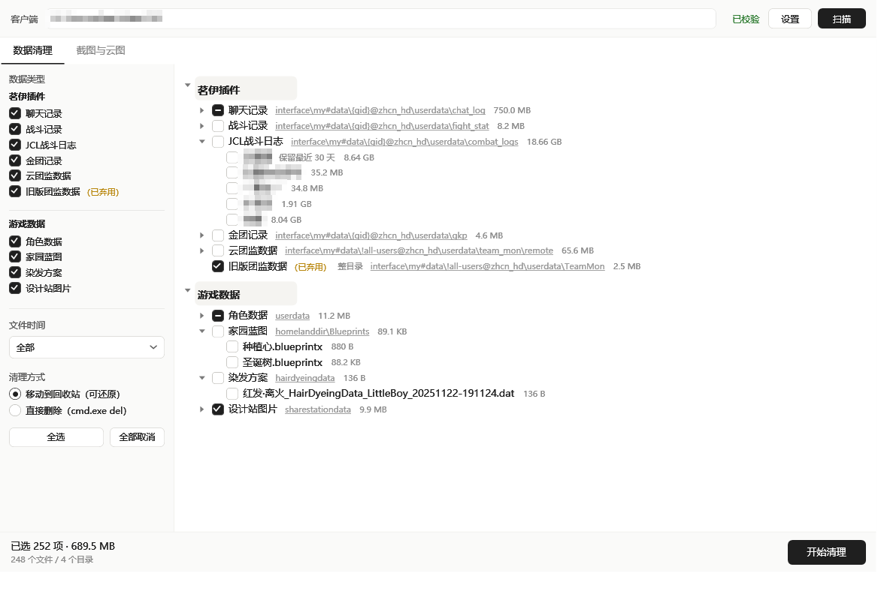
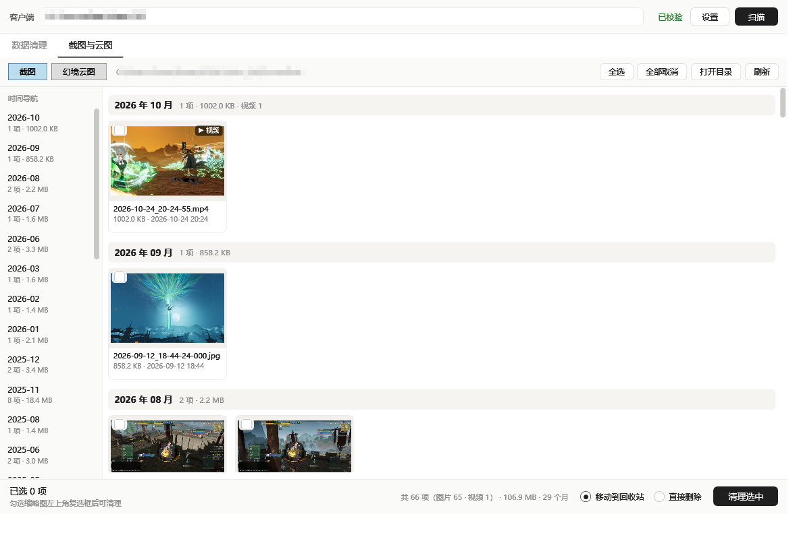
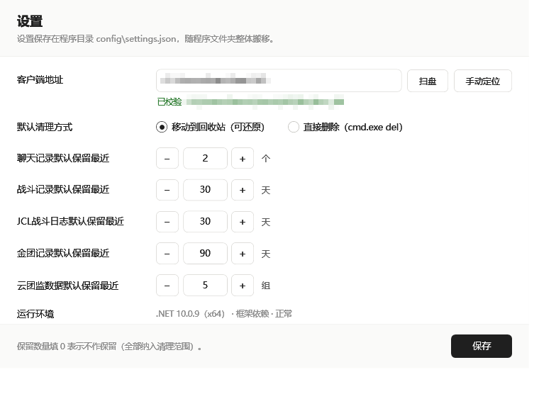
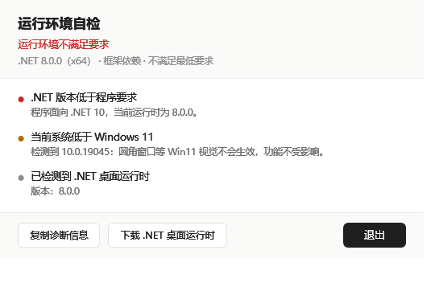

# JX3-Cleaner

《剑网3》V4 客户端的冗余数据清理工具。把「手动清理」文档里的逐层翻目录，变成可勾选、可预览、可回滚的图形化流程。

> **非官方工具**，与西山居 / 金山无关。它只删除客户端自己生成的聊天记录、战斗日志、缓存类数据，**不碰游戏本体与账号凭据**。使用前请读一遍[安全约束](#安全约束)。



## 功能

- **三组分类**：茗伊插件（聊天记录 / 战斗记录 / JCL战斗日志 / 金团记录 / 云团监 / 旧版团监）、懒人插件（插件本体 / 插件数据）、游戏数据（角色数据 / 家园蓝图 / 染发方案 / 设计站图片）
- **保留策略**：聊天记录留最近 N 个、战斗记录与 JCL日志留最近 X/Y 天、金团记录留最近 Z 天、云团监留最近 M 组，全部在设置页调节
- **截图与云图页**：按拍摄月份分组，左侧时间导航定位，缩略图网格（含 mp4 首帧）、单击勾选、双击打开、`FileSystemWatcher` 实时预览
- **两条删除链路**：默认走回收站（可还原），也可选直接删除（红色按钮 + 二次确认）
- **安全兜底**：路径守卫、保护名单、进程检测、逐次审计日志
- **便携化**：配置与日志都在程序目录内，不写注册表、不碰 `%APPDATA%`
- **启动环境自检**：运行时版本 / 位数 / 系统版本不合规时给出中文说明，而不是闪退

## 界面

| 数据清理 | 截图与云图 |
|---|---|
|  |  |

| 设置 | 运行环境自检 |
|---|---|
|  |  |

更多截图：[已弃用分类标记](docs/ui-deprecated.png)、[首次启动的设置页](docs/ui-settings-firstrun.png)、
[自包含发布形态](docs/ui-settings-selfcontained.png)、[无选中底色](docs/ui-tree-no-selection.png)。

> 截图中已打码：本机客户端路径与角色名。

## 文档

| 文档 | 内容 |
|---|---|
| [设计与项目规划](docs/JX3-Cleaner-设计与项目规划.md) | 完整设计基线：客户端结构核对、分类与命名规则、界面分页、保留策略、安全模型、测试矩阵、风险登记册、版本修订记录（当前 v0.12） |
| [截图与云图页](docs/ui-media.png) | 月份分组、时间导航、视频首帧、勾选清理的界面形态 |
| [设置页](docs/ui-settings.png) | 客户端地址 / 清理方式 / 五项保留策略 / 运行环境摘要 |
| [运行环境自检](docs/ui-runtime.png) | 自检失败时的阻断弹窗（可复制诊断信息、直达下载页） |

需求、规则推导与取舍理由都写在设计文档里；README 只保留上手所需的部分。

## 快速开始

```bash
dotnet build                                  # 编译全部
dotnet run --project src/JX3Cleaner.App       # 运行界面
dotnet test  tests/JX3Cleaner.Tests           # 单元测试（135 条）
```

首次启动会**先进入设置页**：点「扫盘」自动搜索，或点「手动定位」自行选择
`…\bin\zhcn_hd` 目录（注意是 `zhcn_hd`，不是 `JX3` 根目录）。校验通过并保存后才进主界面。

### 发布

```bash
# 1) 自包含单文件（目标机无需安装任何 .NET 运行时）
dotnet publish src/JX3Cleaner.App -p:PublishProfile=portable-selfcontained
#   产物：dist/portable/JX3Cleaner.exe（约 62 MB）
mv dist/portable/JX3Cleaner.exe dist/JX3Cleaner-v0.12-selfcontained.exe
rmdir dist/portable

# 2) 框架依赖单文件（目标机需装 .NET 10 桌面运行时）
dotnet publish src/JX3Cleaner.App -c Release -p:SelfContained=false -o publish
#   产物：publish/JX3Cleaner.exe（约 724 KB，单文件但不含运行时）
mv publish/JX3Cleaner.exe dist/JX3Cleaner-v0.12-framework-dependent.exe
rmdir publish
```

两种形态的 exe 都叫 `JX3Cleaner.exe`，**必须在发布后改名**，否则后一次会覆盖前一次。
改完名 `dist/` 里同时留着两个版本：

| 文件 | 体积 | 目标机 |
|---|---|---|
| `dist/JX3Cleaner-v0.12-selfcontained.exe` | 62,072,080 B | 免装 .NET |
| `dist/JX3Cleaner-v0.12-framework-dependent.exe` | 740,968 B | 需 .NET 10 桌面运行时 |

两个 exe 各自跑 `--shot out.png --settings`，设置页「运行环境」会分别显示 `自包含 · 正常` 与
`框架依赖 · 正常` —— 发布形态由编译期元数据写死，不靠路径猜。

> **单文件压缩只对自包含有效**：`EnableCompressionInSingleFile` 在 `App.csproj` 里跟着
> `$(SelfContained)` 走。框架依赖版若也开着压缩会直接失败（`NETSDK1176`）。

### 技术栈

- .NET 10 + WPF（x64），`global.json` 固定 SDK
- 应用图标：`Assets/JX3Cleaner.ico`（16→256 共 7 档），exe 图标与四个窗口的 `Window.Icon` 同源
- 启动时强制软件渲染：`RenderOptions.ProcessRenderMode = RenderMode.SoftwareOnly`
- 零第三方 UI 依赖，回收站走 Shell `IFileOperation`
- Win11 圆角：控件模板（`Themes/Win11.xaml`）+ 窗口级 `DwmSetWindowAttribute`

## 项目结构

```
src/
  JX3Cleaner.Core/     无 UI 依赖，可单测
    Config/            AppSettings、分类目录、保留规则、便携路径
    Discovery/         客户端定位与结构校验（bin\zhcn_hd + bin64）、扫盘
    Environment/       运行环境自检：RuntimeProbe 探测 + RuntimeRequirements 规则
    Scanning/          扫描引擎 + 保留策略（RetentionPolicy）
    Rules/             账号名解析、云团监分组、媒体文件命名
    Planning/          路径守卫、清理计划
    Executing/         回收站 / 直接删除两条执行链路
    Interop/           IFileOperation 等 Shell COM 声明
    Auditing/          审计日志
  JX3Cleaner.Diag/     控制台诊断工具（除 selftest 外不修改任何文件）
  JX3Cleaner.App/      WPF 界面
    Assets/            应用图标（JX3Cleaner.ico 多尺寸 / JX3Cleaner.png 1024px 原始素材）
    SettingsWindow     设置页（含只读的「运行环境」行）
    RuntimeCheckDialog 环境自检失败弹窗
    Controls/          NumberStepper（不可键入的加减框）
    Themes/            Win11 圆角控件模板
    Interop/           缩略图、窗口圆角、截图
    Properties/PublishProfiles/   portable-selfcontained（自包含单文件发布）
tests/
  JX3Cleaner.Tests/    xUnit 135 条
docs/
  JX3-Cleaner-设计与项目规划.md   设计文档
  ui-*.png                       界面截图（已打码）
LICENSE                MIT
```

## 设置项

| 设置项 | 说明 |
|---|---|
| 客户端地址 | 显示真实地址；`扫盘` 在固定磁盘中搜索，`手动定位` 先提示「请定位至旗舰客户端zhcn_hd目录」再打开选择器 |
| 默认清理方式 | 移动回收站 / 直接删除，两个页签共用（互相联动） |
| 聊天记录默认保留最近 N 个 | 步长 1，默认 2，范围 0–60 |
| 战斗记录默认保留最近 X 天 | 步长 5，默认 30，范围 0–3650 |
| JCL战斗日志默认保留最近 Y 天 | 步长 5，默认 30 |
| 金团记录默认保留最近 Z 天 | 步长 5，默认 90 |
| 云团监数据默认保留最近 M 组 | 步长 1，默认 5，范围 0–200 |
| 运行环境 | 只读摘要（如 `.NET 10.0.9（x64） · 框架依赖 · 正常`），悬停看完整诊断 |

加减框不可键入（数值用 `TextBlock` 渲染），到边界时对应按钮禁用。保留数填 `0` 表示不作保留。

配置落在程序目录：`config\settings.json`（设置）、`config\regions.json`（有效大区白名单）、
`logs\clean-YYYYMMDD-HHmmss.json`（审计日志，仅落盘，界面不提供查看）。整个文件夹可随意搬移。

## 可清理项

界面按三组划分（左侧筛选栏与右侧树一致）：

| 组 | 分类 | 路径（相对 `bin\zhcn_hd`） | 粒度 |
|---|---|---|---|
| 茗伊插件 | 聊天记录 | `interface\my#data\{gid}@zhcn_hd\userdata\chat_log` | 按账号，保留最近 N 个 |
| 茗伊插件 | 战斗记录 | `...\{gid}@zhcn_hd\userdata\fight_stat` | 按账号，保留最近 X 天 |
| 茗伊插件 | JCL战斗日志 | `...\{gid}@zhcn_hd\userdata\combat_logs` | 按账号，保留最近 Y 天 |
| 茗伊插件 | 金团记录 | `...\{gid}@zhcn_hd\userdata\gkp` | 按账号，仅日期命名文件，保留最近 Z 天 |
| 茗伊插件 | 云团监数据 | `interface\my#data\!all-users@zhcn_hd\userdata\team_mon\remote` | 按组（`.jx3dat` + `.meta.jx3dat`），保留最近 M 组 |
| 茗伊插件 | 旧版团监数据（已弃用） | `...\userdata\TeamMon` | 整目录，**存在才显示并勾选** |
| 懒人插件 | 懒人插件（已弃用） | `interface\LR_Plugin` | 整目录，**存在才显示并勾选** |
| 懒人插件 | 懒人插件数据（已弃用） | `interface\LR_Plugin@DATA` | 整目录，**存在才显示并勾选** |
| 游戏数据 | 角色数据 | `userdata\{账号}` | 以账号文件夹为整体，行后括号内为角色名 |
| 游戏数据 | 家园蓝图 | `homelanddir\Blueprints` | 按文件 |
| 游戏数据 | 染发方案 | `hairdyeingdata` | 按文件 |
| 游戏数据 | 设计站图片 | `sharestationdata` | 按文件 |

金团记录只清 `年-月-日-时-分-秒_地图名.gkp.jx3dat`；`current.gkp.jx3dat`（当前记录）永久保护，不计体积。

**「（已弃用）」标记**：懒人插件、懒人插件数据、旧版团监数据 三类标题后带黄色小字后缀。它们的目录不存在时，
左栏筛选项与右栏节点**都不出现**；懒人插件类的两项若都不存在，「懒人插件」组标题与分隔线也一起隐藏。

**截图（`ScreenShot`）与幻境云图（`DCIM`）不在这张表里** —— 它们只在「截图与云图」页处理，数据清理页不显示。

## 两个页面

**数据清理**

- 分类行标题后显示灰色相对路径，点击在资源管理器打开对应目录（细项不显示）。
- 组标题（茗伊插件 / 懒人插件 / 游戏数据）只分段，不可勾选；分类行本身可勾选（三态）。
- 树里的行只靠复选框表达状态，鼠标点行**不会出现选中蓝底**。
- 目录不存在的分类不在两栏出现（不是灰显禁用）；组内全空则整组隐藏。
- 角色数据以账号文件夹为整体，行后括号里是角色名；账号下有过期区服时可展开单独勾选。
- 「文件时间」选非「全部」时，下拉框正下方提示 **已过滤 N 项，约 XX MB**（被时间范围排除的量）。

**截图与云图**

- 顶部切换 `截图` / `幻境云图`，缩略图网格按**月分组**，左侧 `YYYY-MM` 时间导航点击即定位。
- 月份取自文件名里的拍摄时间（`2026-10-24_20-24-55.mp4`），取不到才退回文件修改时间 ——
  文件被复制或从备份还原后 mtime 会变，文件名才是真实拍摄时刻。
- 卡片左上角复选框，或直接单击卡片勾选；双击用系统默认程序打开（双击会撤销这次勾选翻转）。
- 勾选项走与数据页相同的 `CleanPlanBuilder` + `PathGuard` + 审计日志。
- 图片与 mp4 同格混排（视频取首帧 + `▶ 视频` 角标），不内联播放。
- 行级虚拟化 + 按需解码 + 滚动释放缩略图，单目录上千张不会一次建满卡片。

## 安全约束

- 所有删除路径先过 `PathGuard`：必须位于 `bin\zhcn_hd` 之下、不在保护名单、非符号链接、非系统文件
- 保护名单包含 `team_mon\local.jx3dat`（云团监本地修改）与各数据根目录本身
- 默认「移动到回收站」；「直接删除」需二次确认且按钮变红
- 清理前检测游戏进程，运行中直接阻断
- 每次清理写审计日志，路径与结果可复核

## 运行环境自检

启动时在**任何窗口出现之前**先跑一次环境自检：

| 结果 | 处理 |
|---|---|
| 致命（非 Windows / 低于 Windows 10 1607 / 32 位进程 / 运行时低于 .NET 10） | 弹自检窗，列出问题、可复制诊断信息、可直达下载页，然后退出（退出码 2） |
| 提示（低于 Win11 / ARM64 模拟 / 借用了更高大版本运行时） | 不拦，只写进自检摘要 |
| 通过 | 静默放行 |

**发布形态决定要不要系统装 .NET**，程序自己不猜：`App.csproj` 用 `AssemblyMetadata` 把
`SelfContained` / `FrameworkDependent` 烧进程序集，运行时直接读这个标记（单文件下 `Assembly.Location` 是空串，
靠路径推断会把自包含误判成框架依赖）。`RollForward=Major` 让框架依赖版在只装了更高大版本运行时的机器上也能启动，自检记为提示。

**已知边界**：.NET 运行时完全没装时，进程内的检查代码根本不会执行（apphost 在托管代码之前就失败），
所以对外分发请用自包含发布。

## 诊断工具

```bash
# 运行环境自检报告（.NET 版本、发布形态、系统版本、已装桌面运行时）
dotnet run --project src/JX3Cleaner.Diag -- env

# 扫描并打印结构报告
dotnet run --project src/JX3Cleaner.Diag -- scan --root "<客户端根目录>"

# 带层级明细 / 只统计 30 天前的文件（同时打印被时间窗口排除的条数与体积）
dotnet run --project src/JX3Cleaner.Diag -- scan --root "..." --detail
dotnet run --project src/JX3Cleaner.Diag -- scan --root "..." --days 30

# 生成清理计划（干跑，不删除）
dotnet run --project src/JX3Cleaner.Diag -- plan --root "..."

# 在临时目录验证回收站与直接删除两条链路
dotnet run --project src/JX3Cleaner.Diag -- selftest
```

界面调试参数（渲染完自动退出）：

```bash
JX3Cleaner.exe --shot out.png                    # 主界面
JX3Cleaner.exe --shot out.png --tab media        # 截图与云图页
JX3Cleaner.exe --shot out.png --month 3          # 点第 4 个月份验证定位
JX3Cleaner.exe --shot out.png --days 90          # 预设文件时间筛选，验证过滤提示
JX3Cleaner.exe --shot out.png --settings         # 设置页
JX3Cleaner.exe --shot out.png --runtime          # 环境自检失败弹窗（用假快照）
```

## 明确不做

- 审计日志的查看页 / 日志目录入口
- 账号名手动校正 UI（自动解析失败显示 `未知账号…后四位`）
- 干跑清单独立预览页（确认弹窗内已给出条数、体积与被拦截数）
- 图片页按体积排序、截图与云图合并浏览、键盘操作
- 多显示器 / 高 DPI 的列数换算专项适配

## 已知待办

- [x] 单文件发布产物验证（自包含约 62 MB，`--settings` 自检显示「自包含 · 正常」）
- [ ] 图片页行数据仍用 `Clear()` + `Add()` 重建，几千项时会有可感知停顿
- [ ] 过期区服与云团监的确认弹窗尚未接入自动化测试

## 免责声明

本项目按「现状」提供，删除操作不可逆（回收站可还原的部分除外）。仓库内的账号、角色名与路径示例均为化名，
截图中的本机路径与角色名已打码。清理前请自行确认目标目录，因误删造成的数据损失由使用者自行承担。

## 许可证

[MIT](LICENSE) © 2026 yimo

`src/JX3Cleaner.App/Assets/` 下的门徽图标来自个人素材库，仅作本项目标识使用；商标与美术资源权利归原作方所有。

